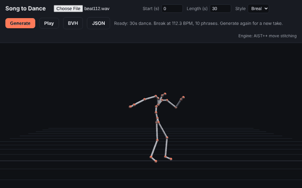

# Song to Dance



Upload a song, then describe the dance you want in plain words, such as *"something energetic like house, 45 seconds from the chorus at 1:10"*. You get a 3D dance choreographed to the music: a skeleton dances in the browser in sync, and you can download the motion as BVH (for Blender, Unity, Maya) or JSON. Everything runs on a laptop CPU, with no GPU, no cloud API and no training.

## Quick start

```bash
pip install -r server/requirements.txt      # also needs ffmpeg on PATH
bash scripts/setup_data.sh                   # downloads AIST++ motions, builds data/library.npz (~1 min)
cd server && uvicorn app:app --port 8000     # open http://localhost:8000
```

Or with Docker: `docker build -t song-to-dance . && docker run -p 7860:7860 song-to-dance`, then open http://localhost:7860.

## Deploy (Hugging Face Space)

The Space uses the free Gradio SDK (ZeroGPU hardware, though nothing here needs the GPU). `app.py` at the repo root builds the move library on first boot (about a minute), fetches the optional on-device LLM in the background, and serves the app on port 7860. `packages.txt` installs ffmpeg.

`.github/workflows/deploy-space.yml` pushes `main` to the Space. Add a `HF_TOKEN` secret (write token) and a `HF_SPACE` variable (e.g. `your-name/song-to-dance`) under the GitHub repo's Settings > Secrets and variables > Actions, then re-run the workflow.

## How it works (default engine: `stitch`)

This is music-driven motion retrieval and synthesis, a lightweight version of motion-graph systems such as ChoreoMaster. It uses 411 real dance sequences from [AIST++](https://google.github.io/aistplusplus_dataset/) in SMPL format, across 10 genres.

1. **Library** (`server/build_library.py`). Each AIST++ sequence was danced to a track with a known tempo, which is encoded in its music id (e.g. `mPO3` is 110 BPM). A spectral check of the dancers' joint speed agrees with this table. The beat phase of each clip is fitted to the dancer's own "hits", meaning the local minima of joint speed.
2. **Song analysis** (`choreographer.analyse_song`). librosa tracks beats, and RMS loudness plus onset strength give the energy of each beat. Tempos are folded into the 75 to 140 BPM range that the dancers used.
3. **Phrase selection**. Clips are cut into 8-beat, bar-aligned phrases (about 1,000 in total). Each next phrase is sampled from the best 8 by a cost made of four parts:
   - how smoothly its start pose joins the previous phrase's end pose (joint rotation distance),
   - how well its movement energy fits the music's energy (percentile match),
   - how close its tempo is to the song's,
   - a penalty for repeating a recent clip.

   The random seed makes every Generate a new take.
4. **Synthesis**. Each phrase is time-warped beat by beat onto the song's tracked beat times, so moves land on the beat even when the tempo drifts. The joins are cross-faded with quaternion blending, the feet are kept on the floor, and the dancer's travel continues from the previous phrase.

On a synthetic 112 BPM test track, the AIST++-style beat-alignment score (music beats against motion hits, sigma 0.1 s) is 0.65 to 0.8 for House, Break, Krump and LA Hip-hop. It is about 0.45 for Pop and Street Jazz, whose hits aren't always speed minima. An unaligned raw clip scores 0.53. Generating a 30 s dance takes a few seconds on CPU.

### The AI choreographer (`server/choreo_llm.py`)

An LLM is the creative decision-maker; the retrieval engine is the performer.

1. **Song structure.** The song's 8-beat phrases are grouped into 2 to 4 sections by music energy (quiet, medium, loud), for example intro, peak and ending.
2. **Plan.** Given those sections and the user's vibe or story ("a shy robot who goes wild at the drop"), Qwen2.5-0.5B-Instruct (Hugging Face transformers, CPU) writes a plan. Each section gets a style, an energy (calm, steady or intense), a move idea and a one-line reason. The plan shows in the side panel and on the timeline.
3. **Constrained decoding.** Small models are unreliable at free-form JSON, so the decoder feeds the JSON skeleton itself. Style and energy are picked only among valid options through a token trie, and free-text fields stop at their closing quote. The output is always valid. Story words nudge the option scores, for example "battle" toward Krump and "rain" toward Ballet Jazz, and a style the user names explicitly is enforced.
4. **Performance.** Each phrase slot gets the plan's style and energy, and the stitcher picks real AIST++ moves that fit.
5. **Refinement by chat.** "Make the ending calmer" rewrites only the sections the request is about, and phrases in untouched sections keep their exact moves.
6. **Body constraints** (`server/constraints.py`). Phrases like "keep the left hand still", "arms crossed in the intro", "no big leg kicks" or "right arm raised at the drop" become rules: limb, mode (hold, keep small, raise, cross, down) and sections. They are applied to the SMPL joint rotations of that limb after stitching, with smooth ramps, while the rest of the body keeps dancing. The arm poses were solved with IK on the skeleton. Parsing is rule-based, so constraints work even when the LLM is unavailable, and a body-only request doesn't spend an LLM call.
7. **Fallback.** If the model isn't loaded, a rule-based plan follows the music's energy, so the app never breaks.

Other features include a per-phrase re-roll (↻), a built-in synthesized demo track, beat-reactive visuals (disco floor, beams, trails and bloom), BVH and JSON export, and video recording from the browser.

To run the LLM locally: `pip install torch transformers`. The model (about 1 GB) downloads on first boot of `app.py`, or you can use `python -c "import sys; sys.path.insert(0,'server'); import choreo_llm; choreo_llm.download()"`.

Other engines (`MODE` env var):
- `edge`: pretrained [EDGE](https://github.com/Stanford-TML/EDGE) diffusion model conditioned on Jukebox features, built with `Dockerfile.edge`. It needs a GPU with about 24 GB and is untested.
- `mock`: procedural motion, for UI work only.

## Files

- `server/choreographer.py`: the beat analysis, phrase selection and stitching.
- `server/choreo_llm.py`: the AI choreographer (LLM plan with constrained decoding, refinement, rule fallback).
- `server/intent.py`: reads length and start time from typed requests.
- `server/sample_track.py`: the synthesized demo track.
- `server/build_library.py`: builds the move library. `server/aist_io.py` reads the AIST++ pickles with a numpy-only unpickler.
- `server/motion.py`: forward kinematics on an SMPL-like skeleton, y-up normalisation, and BVH/JSON export.
- `server/app.py`: the FastAPI job API and static web app.
- `web/index.html`: the three.js viewer, with three.js vendored.

## Licensing

The motion comes from AIST++, so check its license terms before any commercial use. No SMPL body model file is shipped: the skeleton uses an approximate SMPL-like joint template. EDGE's checkpoint, which only the optional engine uses, is research-only. This setup is fine for portfolios and demos.

## Roadmap

1. Skinned avatar (a rigged glTF character retargeted from the SMPL joints) in place of the skeleton.
2. A larger LLM on GPU (ZeroGPU) for richer plans; per-phrase move descriptions matched with text embeddings.
3. Learned music-to-move matching (e.g. a small contrastive model on AIST++ music and motion) to replace the energy and tempo heuristics.
4. Practice mode: compare the user's webcam pose (MediaPipe) with the dance and score it.
5. EDGE on a free Kaggle or Colab GPU as a second engine.
